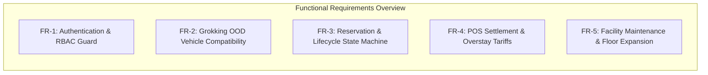

# Software Requirements Specification (SRS)
## Autonomous Smart Parking Management System (AS-PMS)

---

### 1. Introduction

#### 1.1 Purpose
This Software Requirements Specification (SRS) document details the functional and non-functional requirements for the Autonomous Smart Parking Management System (AS-PMS). Designed for high-density multi-floor parking infrastructures, the system provides automated stall allocation, OOD-compliant vehicle size enforcement, pessimistic concurrency governance, real-time POS toll settlements, and automated lifecycle reclamation.

#### 1.2 Scope
The scope of AS-PMS encompasses:
- Decoupled RESTful API Gateway delivering sub-100ms request/response cycles.
- Multi-floor stall management with dynamic level expansion (P1, P2, P3).
- Strict 3-tier Role-Based Access Control (Admin, Gate Operator, Customer).
- Grokking Object-Oriented Design (OOD) vehicle-to-stall compatibility matrix.
- Lifespan background reaper worker executing automated no-show reclamation.
- Digital self-service mobile pass clearance and Point of Sale (POS) exit gate settlement.

---

### 2. Overall Description

#### 2.1 System Environment & Architecture
AS-PMS operates as an asynchronous, single-server multi-tiered application. The backend is written in Python (FastAPI, SQLAlchemy, SQLite WAL), communicating over JSON/REST with a single-page web application (HTML5, ES6+, Tailwind CSS).

#### 2.2 User Classes and Roles
- **Chief Administrator (`ADMIN`)**: Oversees facility master data, configures hourly tariffs and overstay penalties, toggles stall maintenance states, commissions new floors/stalls, and audits financial logs.
- **Gate Attendant / Operator (`OPERATOR`)**: Manages physical ingress and egress gates, processes 1-click check-ins for pre-reserved vehicles, dispenses active tickets, scans digital passes, and executes physical POS payments.
- **Registered Customer / Driver (`CUSTOMER`)**: Inspects live floor occupancy, executes atomic reservations, tracks digital gate passes, and settles parking fees online via simulated UPI/Card.

---

### 3. Functional Requirements (FR)

#### FR-1: Authentication & Cryptographic Role-Based Access Control
- **FR-1.1**: The system shall authenticate users via `POST /api/auth/login` using username and BCrypt-hashed passwords (`bcrypt.gensalt()`).
- **FR-1.2**: Upon successful credential verification, the system shall issue a signed JSON Web Token (JWT) using `HS256` encoding containing `sub` (username), `role` (ADMIN, OPERATOR, or CUSTOMER), and an 8-hour expiration timestamp.
- **FR-1.3**: The API Gateway shall intercept all secured endpoints via `require_role([...])` dependency injection. Unauthorized role access shall immediately abort with `HTTP 403 Forbidden`. Missing or invalid tokens shall abort with `HTTP 401 Unauthorized`.
- **FR-1.4**: Passwords shall never be stored in plain text. Default administrative and operator accounts shall be seeded automatically during application lifespan startup if missing.

#### FR-2: Grokking OOD Vehicle-to-Stall Compatibility Enforcement
- **FR-2.1**: The system shall categorize vehicles into five standard types: `MOTORBIKE`, `CAR`, `VAN`, `TRUCK`, and `ELECTRIC`.
- **FR-2.2**: The system shall categorize parking stalls into four physical dimensions: `MOTORBIKE`, `COMPACT`, `LARGE`, and `ELECTRIC`.
- **FR-2.3**: Compatibility rules adhering strictly to Grokking Reference Object-Oriented Design shall be enforced across booking and check-in:
  - `MOTORBIKE` may occupy `MOTORBIKE`, `COMPACT`, or `LARGE` stalls.
  - `CAR` may occupy `COMPACT` or `LARGE` stalls.
  - `VAN` may occupy `LARGE` stalls strictly.
  - `TRUCK` may occupy `LARGE` stalls strictly.
  - `ELECTRIC` may occupy `ELECTRIC`, `COMPACT`, or `LARGE` stalls.
- **FR-2.4**: Any attempt to place a vehicle in an incompatible stall (e.g., `CAR` into a `MOTORBIKE` stall, or `TRUCK` into a `COMPACT` stall) shall be rejected with `HTTP 400 Bad Request`: `"Size Mismatch: Vehicle cannot fit in this stall."`
- **FR-2.5**: Automated stall allocation (`AUTO-ASSIGN`) shall filter available spots dynamically, returning the nearest compatible stall to the ingress gate.

#### FR-3: Reservation Lifecycle & Background Reaper Daemon
- **FR-3.1**: Customers may reserve an available stall for a specified 2-hour window. The system shall atomically transition stall status from `AVAILABLE` to `RESERVED`.
- **FR-3.2**: A background asynchronous task (`reservation_reaper_daemon`) shall execute every 60 seconds.
- **FR-3.3**: If a vehicle fails to check in at the inbound gate within 15 minutes of reservation issuance (`issued_at`), the ticket status shall transition to `EXPIRED`, and the stall shall be reclaimed back to `AVAILABLE`.
- **FR-3.4**: If a driver presents an expired ticket at the inbound gate, the gate controller shall reject entry with `HTTP 400 Bad Request`: `"Entry Denied: Reservation has EXPIRED due to no-show."` The barrier gate shall remain locked down.
- **FR-3.5**: The Operator Inbound terminal shall render a real-time "Pending Bookings" quick-select list of all unfulfilled `RESERVED` tickets. Clicking a pending vehicle card shall automatically populate the check-in input and vehicle type.

#### FR-4: Billing Calculation, Overstay Penalties, and POS Settlements
- **FR-4.1**: All datetime comparisons for billing shall be evaluated in timezone-aware UTC (`datetime.now(timezone.utc)`).
- **FR-4.2**: **Immediate Exit Grace Period**: If duration is $\le 2$ minutes AND no overstay past the reserved window occurred, total amount due shall be ₹0.00.
- **FR-4.3**: **Standard Tier Rates**: Durations exceeding 2 minutes shall be billed at hourly progressive rates:
  - Hour 1: Base first-hour rate (₹50.00)
  - Hours 2 and 3: Second/third-hour rate (₹30.00/hr)
  - Hours 4+: Remaining-hour rate (₹20.00/hr)
- **FR-4.4**: **Overstay Penalty Multiplier**: If actual exit time exceeds `booked_end`, excess hours shall incur a statutory $1.5\times$ penalty multiplier:
  $$\text{Overstay Fee} = \lceil\text{Excess Hours}\rceil \times \text{Remaining Hourly Rate} \times 1.5$$
- **FR-4.5**: **Non-Conflicting Digital Pass Settlement**:
  - Customers may settle active parking tickets online via UPI/Card. The ticket transitions to `PAID`, sets `is_prepaid = True`, and grants a 15-minute exit window.
  - If a ticket is already `PAID`, subsequent calls to `/api/customer/pay` shall return `HTTP 400 Bad Request`: `"Ticket already settled."`
  - When scanning a pre-paid ticket at the exit booth, the POS terminal shall verify prior settlement and display: `"PAYMENT VERIFIED: Settled Online via UPI. Net Due: ₹0.00"`.
  - In `frontend/index.html`, settled tickets shall display the green receipt banner: `"✓ DIGITAL PASS SETTLED (₹[amount]) — EXIT CLEARED"`.
- **FR-4.6**: **Lost Ticket Override**: Customers who lose their physical or digital pass shall be billed a flat penalty fee of ₹500.00.

#### FR-5: Multi-Floor Capacity Expansion & Maintenance Management
- **FR-5.1**: Administrators shall be capable of creating parking stalls on Floor 1 (P1 Ground), Floor 2 (P2 Level 2), and Floor 3 (P3 Level 3).
- **FR-5.2**: If an Administrator adds a stall to a floor number that does not yet exist in `parking_floors`, the system shall dynamically create that floor record on the fly without raising foreign key constraint violations.
- **FR-5.3**: Administrators can toggle any stall between operational and maintenance mode via `PATCH /api/admin/spots/{spot_id}/status`. Maintenance stalls (`MAINTENANCE`) are rendered in gray as `"OUT OF SERVICE"` and are excluded from public reservation and auto-assignment.

---

### 4. Non-Functional Requirements (NFR)

#### NFR-1: High Concurrency, Pessimistic Locking & ACID Compliance
- **NFR-1.1**: The database shall operate in SQLite Write-Ahead Logging (`WAL`) mode with `synchronous=NORMAL` and `busy_timeout=5000` to eliminate database locked errors during multi-threaded requests.
- **NFR-1.2**: Critical allocation routes (`/api/customer/reserve` and `/api/operator/check-in`) shall serialize access using `with db_write_lock` combined with SQLAlchemy `with_for_update()`.
- **NFR-1.3**: When two or more concurrent requests attempt to reserve the exact same parking stall in the same millisecond, exactly one request shall succeed with `HTTP 200 OK`, while all other competing requests shall be cleanly rejected with `HTTP 409 Conflict`. Zero double-bookings shall occur under any load.

#### NFR-2: Sub-100ms Response Latency
- **NFR-2.1**: All core transactional endpoints (`/api/auth/login`, `/api/floors`, `/api/customer/reserve`, `/api/operator/check-in`, `/api/operator/scan-fee`) shall complete execution in under 100 milliseconds under nominal local load.
- **NFR-2.2**: The single-page frontend application shall load all assets from local static mounts in under 200 milliseconds without external blocking script dependencies.

#### NFR-3: Data Integrity & Immutable Audit Trail
- **NFR-3.1**: Every security-sensitive or financial event (user registration, stall creation, reservation, check-in, overstay simulation, online payment, booth checkout, and reaper sweeps) shall append an immutable record to the `audit_logs` table.
- **NFR-3.2**: Audit records shall capture timestamp (UTC), actor username, actor role, action identifier, IP address, and itemized transaction details.
- **NFR-3.3**: Foreign keys linking stalls to floors, tickets to stalls, and payments to tickets shall enforce relational integrity, preventing orphaned records.
