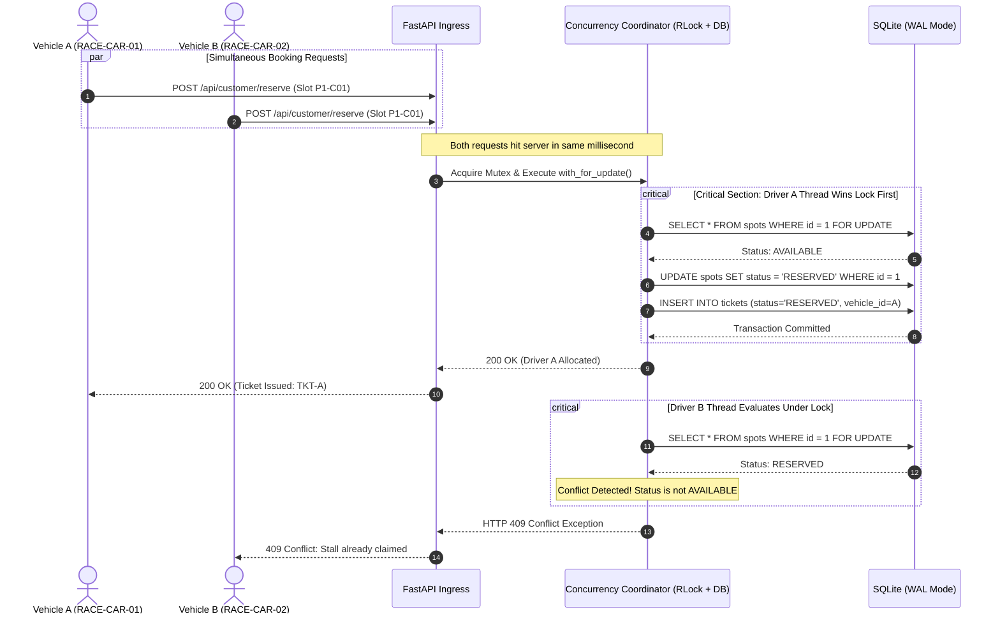
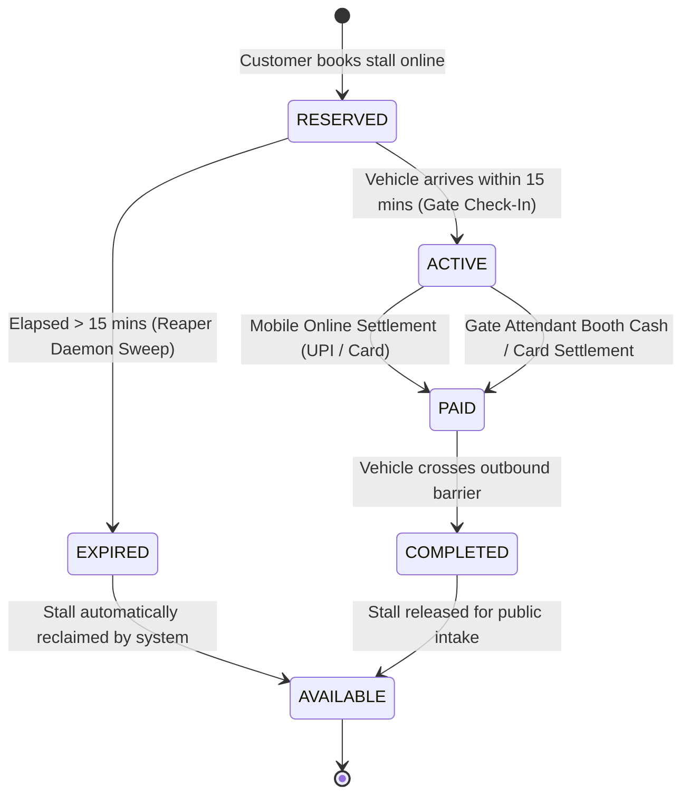

# System Architecture Specification
## Multi-Tiered Intelligent Parking Management & Automation Platform

---

### Executive Architectural Summary
The Parking Management Platform is architected as an enterprise-grade, decoupled client-server system designed to govern high-throughput vehicle intake, dynamic stall allocation, automated lifecycle enforcement, and audit-compliant POS settlements. Built upon modern asynchronous Python foundations and standards-compliant web technologies, the system delivers sub-100ms response latencies and guarantees ACID transaction semantics under heavy concurrent booking contention.

---

```mermaid
graph TD
    subgraph Client Tier [Presentation & Edge Tier]
        SPA["Single-Page Dashboard (Vanilla JS / Tailwind / FontAwesome)"]
        Scanner["Optical Barcode / QR Simulation Layer"]
        Sim["Faculty Edge-Case & Stress Diagnostics Drawer"]
    end

    subgraph Gateway Tier [API Gateway & Ingress Layer]
        FastAPI["FastAPI Ingress Router (Port 8000)"]
        AuthMiddleware["JWT Authentication & RBAC Guard Engine"]
        StaticEngine["StaticFiles Middleware (/ -> ../frontend)"]
    end

    subgraph Core Engine Tier [Business Logic & Orchestration]
        CompatEngine["Vehicle-to-Stall Compatibility Engine (Grokking OOD)"]
        TariffEngine["Tiered Tariff & Overstay Penalty Engine"]
        StateEngine["Ticket State Machine & Barrier Controller"]
        ReaperDaemon["Asyncio Lifespan Reaper Daemon (15m Sweeper)"]
    end

    subgraph Data Tier [Persistence & Concurrency Control]
        PessimisticLock["Pessimistic Row Lock (with_for_update + RLock)"]
        SQLAlchemyORM["SQLAlchemy 2.0 ORM"]
        SQLiteWAL["SQLite Database Engine (WAL Mode + busy_timeout=5000ms)"]
    end

    SPA -->|HTTPS / REST API + JWT| FastAPI
    Scanner -->|Ticket Token Ingest| FastAPI
    Sim -->|Concurrency / Time Travel Injections| FastAPI

    FastAPI --> AuthMiddleware
    FastAPI --> StaticEngine
    AuthMiddleware --> CompatEngine
    AuthMiddleware --> TariffEngine
    AuthMiddleware --> StateEngine

    StateEngine --> PessimisticLock
    ReaperDaemon -->|Periodic Sweep (Every 60s)| PessimisticLock
    PessimisticLock --> SQLAlchemyORM
    SQLAlchemyORM --> SQLiteWAL
```

---

### 1. Tiered Architectural Decomposition

#### 1.1 Presentation Tier (Client)
- **Zero-Dependency Modern Web Client**: Built with semantic HTML5, Vanilla JavaScript (ES6+), and styled using Tailwind CSS and FontAwesome industrial iconography.
- **Role-Segmented Operational Interfaces**:
  - **Chief Administrator Console**: Live multi-floor capacity gauges, stall maintenance master, automated floor expansion, system tariff configuration, and financial audit logs.
  - **Gate Attendant Terminal**: 1-click quick-select for pre-reserved inbound vehicles, optical ticket validation, barrier servo telemetry, and POS checkout cash register.
  - **Customer Self-Service Portal**: Live visual floor occupancy map, pre-booking engine, and real-time digital pass generator with mobile UPI settlement.
- **Faculty Edge-Case Console**: Integrated drawer for live viva demonstrations (multi-vehicle concurrency race injector, overstay penalty backdater, and no-show sweep trigger).

#### 1.2 Ingress & Security Tier (API Gateway)
- **FastAPI Asynchronous Gateway**: Asynchronous ASGI server running on Uvicorn, handling high-concurrency non-blocking I/O.
- **Cryptographic Token Engine**: Stateless JSON Web Token (JWT) distribution utilizing HMAC-SHA256 signatures with 8-hour token expiration.
- **Strict Role-Based Access Control (RBAC)**: Declarative dependency injection via `require_role([...])` enforcing zero-trust endpoint access across three hierarchical roles: `ADMIN`, `OPERATOR`, and `CUSTOMER`.
- **Clean Fallback Static Asset Routing**: Serves the single-page frontend application seamlessly at the root path (`/`) via Starlette `StaticFiles(directory="../frontend", html=True)`.

#### 1.3 Core Business Application Engine
- **Object-Oriented Compatibility Engine (Grokking OOD)**: Enforces physical slot sizing constraints preventing oversized vehicles from occupying undersized stalls.
- **Dynamic Tariff Calculation Engine**: Computes exact billing across progressive hourly intervals, validates short-duration grace periods, and applies statutory 1.5x overstay multipliers.
- **Active Lifecycle State Machine**: Dictates permissible transitions for parking passes (`RESERVED` -> `ACTIVE` -> `PAID` / `COMPLETED` / `EXPIRED`).
- **Autonomous Lifespan Reaper Worker**: Background `asyncio` task managed via FastAPI's `lifespan` context, sweeping stale reservations every 60 seconds.

#### 1.4 Data Tier & Persistence Mechanics
- **Database Engine**: Relational SQLite 3 configured with enterprise performance PRAGMAs:
  - `PRAGMA journal_mode=WAL`: Write-Ahead Logging allows concurrent readers to operate without blocking writers and vice versa.
  - `PRAGMA synchronous=NORMAL`: Balances ACID guarantees with low disk write latency.
  - `PRAGMA busy_timeout=5000`: Queues lock contention gracefully up to 5,000ms before rejecting transactions.
- **Pessimistic Concurrency Architecture**: Combines Python re-entrant thread locks (`threading.RLock`) with SQLAlchemy `with_for_update()` queries to serialize stall reservation updates at the database layer.

---

### 2. Concurrency Control & Double-Booking Elimination



#### Mathematical Proof of Atomic Mutual Exclusion
To guarantee that under no circumstances two requests $R_1, R_2$ acquire the same stall $S_k$ at time $t$:
Let $\mathcal{L}$ represent the database write lock. Any state transition function $T: S_k \to S_k'$ requires:
$$\text{Acquire}(\mathcal{L}) \implies \text{Verify}(S_k.\text{status} = \text{AVAILABLE}) \implies \text{Commit}(S_k.\text{status} \leftarrow \text{RESERVED}) \implies \text{Release}(\mathcal{L})$$
If $R_1$ holds $\mathcal{L}$, $R_2$ is blocked in queue until $R_1$ commits. Upon $R_2$ entry, $S_k.\text{status} \neq \text{AVAILABLE}$, triggering an immediate HTTP 409 Conflict rejection.

---

### 3. Background Lifespan Reaper Daemon

The application runs a non-blocking background daemon using Python's `asyncio` task scheduler within the application lifecycle context:



#### Workflow Mechanics:
1. **Startup Initialization**: On FastAPI lifespan startup, `asyncio.create_task(reservation_reaper_daemon())` is spawned.
2. **Periodic Evaluation Interval**: The loop executes every 60 seconds (`asyncio.sleep(60)`).
3. **Threshold Calculation**: Reclaims any reservation where:
   $$t_{\text{current}} - t_{\text{issued}} > \Delta_{\text{hold\_window}} \quad (\text{default: } 15 \text{ minutes})$$
   $$\text{and } \text{status} = \text{RESERVED}$$
4. **Reclamation Execution**: Under atomic row lock, the ticket status is marked `EXPIRED`, the associated parking stall is restored to `AVAILABLE`, and an audit event is appended to `audit_logs`.
5. **Gate Rejection Shield**: If an expired vehicle arrives at the gate, check-in is rejected with HTTP 400 Bad Request, keeping the inbound barrier closed.

---

### 4. Dynamic Tariff Calculation & Overstay Multiplier Engine

The tariff calculation algorithm processes four pricing dimensions:

```mermaid
flowchart TD
    Start([Calculate Parking Fee]) --> IsLost{Ticket Lost?}
    IsLost -- Yes --> LostFee[Apply Flat Lost Ticket Fee: ₹500.00] --> Output([Return Total Amount Due])
    
    IsLost -- No --> CalcDuration[Compute Exact Elapsed Time in UTC]
    CalcDuration --> CheckGrace{Duration <= 2 mins AND No Overstay?}
    CheckGrace -- Yes --> Grace[Immediate Grace Period Applied: ₹0.00] --> Output
    
    CheckGrace -- No --> BaseHours[Compute Base Hours: ceil(elapsed_time)]
    BaseHours --> Tier1[Hour 1: ₹50.00]
    Tier1 --> Tier2[Hours 2-3: ₹30.00/hr]
    Tier2 --> Tier3[Hours 4+: ₹20.00/hr]
    
    Tier3 --> OverstayCheck{Exit Time > Booked End Time?}
    OverstayCheck -- No --> SumBase[Total = Base Tier Fee] --> Output
    OverstayCheck -- Yes --> ExcessCalc[Compute Excess Hours: ceil(exit - booked_end)]
    ExcessCalc --> PenaltyCalc[Overstay Penalty = Excess Hours * Remaining Rate * 1.5x Multiplier]
    PenaltyCalc --> SumTotal[Total = Base Tier Fee + Overstay Penalty] --> Output
```

#### Formal Algorithmic Specification:

$$\text{Duration} = \max(0, t_{\text{exit}} - t_{\text{entry}})$$
$$\text{Duration}_{\text{minutes}} = \lfloor \text{Duration} / 60 \rfloor$$

**Condition 1: Lost Ticket**
$$\text{Fee} = \text{Rate}_{\text{lost}} \quad (\text{₹}500.00)$$

**Condition 2: Immediate Exit Grace Period**
$$\text{If } \text{Duration}_{\text{minutes}} \le 2 \text{ and } t_{\text{exit}} \le t_{\text{booked\_end}} \implies \text{Fee} = \text{₹}0.00$$

**Condition 3: Tiered Hourly Parking Fee ($B$)**
Let $h_{\text{base}} = \max(1, \lceil \text{Duration} / 3600 \rceil)$:
$$B = \sum_{i=1}^{h_{\text{base}}} \text{Rate}(i)$$
$$\text{Rate}(i) = \begin{cases} \text{₹}50.00, & i = 1 \\ \text{₹}30.00, & i \in \{2, 3\} \\ \text{₹}20.00, & i \ge 4 \end{cases}$$

**Condition 4: Overstay Penalty Multiplier ($P$)**
If $t_{\text{exit}} > t_{\text{booked\_end}}$:
$$h_{\text{excess}} = \max(1, \lceil (t_{\text{exit}} - t_{\text{booked\_end}}) / 3600 \rceil)$$
$$P = h_{\text{excess}} \times \text{Rate}_{\text{remaining}} \times M_{\text{overstay}} = h_{\text{excess}} \times 20.00 \times 1.50$$

**Total Billable Charge:**
$$\text{Total Fee} = B + P$$

---

### 5. Role-Based Access Control (RBAC) Security Architecture

Access control is enforced at the controller level using FastAPI's dependency injection chain `Depends(require_role([...]))`.

| Security Domain | Endpoint Path | HTTP Method | Minimum Role | Enforced Security Constraints |
|:---|:---|:---:|:---:|:---|
| **Authentication** | `/api/auth/login` | `POST` | Public | Validates credentials; returns signed JWT bearer token. |
| **Authentication** | `/api/auth/me` | `GET` | Authenticated | Decodes JWT; returns current user identity and permissions. |
| **Customer Ops** | `/api/customer/reserve` | `POST` | `CUSTOMER` | Atomic stall reservation with compatibility checking. |
| **Customer Ops** | `/api/customer/my-tickets` | `GET` | `CUSTOMER` | Scoped strictly to authenticated customer user ID. |
| **Customer Ops** | `/api/customer/pay` | `POST` | `CUSTOMER` | Rejects already settled tickets; grants 15m exit pass. |
| **Gate Operations** | `/api/operator/check-in` | `POST` | `OPERATOR` | Auto/manual intake; validates vehicle size against stall. |
| **Gate Operations** | `/api/operator/scan-fee` | `GET` | `OPERATOR` | Exit scan; verifies pre-paid digital status or computes dues. |
| **Gate Operations** | `/api/operator/check-out` | `POST` | `OPERATOR` | Collects payment, releases stall, triggers barrier servo open. |
| **Administration** | `/api/admin/spots` | `POST` | `ADMIN` | Adds stalls; dynamically auto-creates missing floor records. |
| **Administration** | `/api/admin/spots/{id}/status`| `PATCH` | `ADMIN` | Toggles operational maintenance mode on individual stalls. |
| **Administration** | `/api/admin/rates` | `PUT` | `ADMIN` | Updates pricing tariffs and overstay multiplier dynamically. |
| **Administration** | `/api/admin/audit-logs` | `GET` | `ADMIN` | Read-only inspection of immutable system audit trails. |
| **Administration** | `/api/admin/financial-summary`| `GET` | `ADMIN` | Real-time shift collections, revenue splits, and occupancy. |
